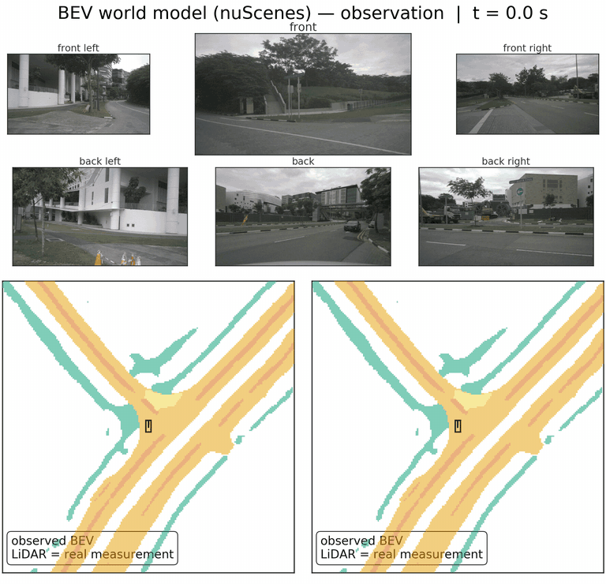

# BEV World Model — Forecasting Fused BEV Latents (nuScenes)

A compact Transformer forecasts the next fused bird's-eye-view (BEV) latent
of a frozen BEVFusion perception stack 0.5 s ahead from three preceding
latents; the original frozen segmentation and detection heads decode the
forecast without retraining the perception system.

This is the **public companion repository** of the paper
*"Extending BEV Perception into the Future: Reusing Frozen Perception Stack"*
(IEEE Intelligent Vehicles Symposium, IV 2027). It provides the demo media,
the self-contained demo pipeline, and the full source code with an
English packaging (semantics unchanged).

## Demo



Top: all six nuScenes cameras (2 Hz). Bottom: LiDAR point cloud (grayscale,
colored by return **intensity** — it is the *real measurement of the future
frame*, not part of the forecast; ego vehicle sketched at (0,0), front =
up) with the BEV map segmentation: left = world-model forecast (pure —
the colored maps are everything the model predicts), right = real latent
(reference; red boxes = actual traffic at that instant, ground truth).
The badge per step gives the proxy mIoU (forecast vs. decoded real latent)
and the scene's mean gate α (the model's copy/predict statistic); the inset
tracks the mIoU decay (the persistence baseline decays even faster — its
curve is in the NPZ). Scene selection is disclosed: the
scene-start window with the largest mean gate activation — no
image-quality cherry-picking. Length: 3 context frames + k = 21 rollout
steps (10.5 s); the decay over the horizon is visible *and* honest.

| Asset | Scene | Notes |
|---|---|---|
| `img/maps_gate_pure.gif` | gate-α maximum | pure map-only display (no LiDAR/boxes) |
| `img/maps_crossing_pure.gif` | gate-α minimum | pure map-only display, crowd crossing |
| `img/rollout_filmstrip.png` | dynamic | paper-style filmstrip (context + k = 1..4) |

## Headline results (full validation, against nuScenes annotations)

| Metric | Persistence | World model | Real latent (reference) |
|---|---|---|---|
| Map segmentation (mIoU, 6 classes) | 0.4647 | **0.5898** | 0.6295 |
| 3D detection (mAP, energy + cosine) | 0.1696 | **0.3752** | 0.6858 |

- ~6 M parameters, 4.4–11.5 ms per forecast step (TITAN RTX), plus ~173 ms
  for the separately executed BEVFusion encoder.
- Task-dependent objectives: dense segmentation needs little beyond
  Smooth-L1 reconstruction + channel-spread matching; sparse detection
  additionally benefits from energy weighting and cosine alignment.
- Autoregressive rollout beats persistence at every step up to k = 10 (5 s).

## Repository structure

Flat library layout: all model modules live in the repository root.

```
├── train_linux.py            # training conductor (locally + cluster)
├── inference.py              # proxy evaluation seg (300-window subset)
├── eval_full_val.py          # full-validation seg (5,743 windows)
├── rollout_eval.py           # autoregressive rollout evaluation
├── bev_dataset.py            # latent dataset (windows, packed memmap, HDF5)
├── bev_dataloader.py         # dataloader factory (multiple PKL sources)
├── bev_world_model.py        # the world model (transformer + gate + head)
├── transformer.py            # Pre-LN transformer blocks, embeddings
├── embedding.py, output_head.py, upsampling_head.py, flow_head.py
├── seg_decoder_torch.py      # frozen BEVFusion seg decoder + IoU utilities
├── config.py, downsampling.py, checkpointing.py
├── pack_latents.py, build_hdf5_cache.py, shm_staging.py, test_output.py
├── tools/                    # head adaptation: adapt_seg_head.py (decoder,
│                             #   seg) and adapt_det_head.py (TransFusion, det)
├── bevfusion_patch/          # latent extraction/injection: latent_saver.py
│                             #   + hook instructions (SAVE_/LOAD_BEV_LATENTS)
├── configs/                  # example configs (best operating points seg/det)
├── scripts/                  # demo scripts (rollout compute + renders)
├── img/                      # demo media (hero videos/GIFs, filmstrip)
├── environment.yml           # conda reference environment (training/inference)
└── requirements.txt          # the same environment as a pip variant
```

Comments, docstrings, and console output are English (repackaged from the
original codebase); markdown tables and code semantics are unchanged.

## Setup

```bash
# conda variant (recommended):
conda env create -f environment.yml && conda activate bevwm
# pip variant (Python 3.10, CUDA 12.1):
pip install -r requirements.txt
```

## Reproducing the demos

`scripts/` reproduces the rollout demos; they import the model, dataset,
and frozen decoder from this repository (`train_linux.py`, `Code/`):

```bash
# 1. Rollout + decoding + gate-alpha scene selection -> NPZ
python3 scripts/rollout_compute.py \
    --data-root  path/to/nuscenes/complete \
    --pkgs-root  path/to/nuscenes/latents_packed_fp16 \
    --checkpoint checkpoints/00_BEST/seg/best_miou.pt \
    --seg-head   path/to/bevfusion-seg.pth \
    --k 21 --out iv_rollout.npz

# 2a. Paper-style filmstrip (PNG/PDF)
python3 scripts/render_filmstrip.py --npz iv_rollout.npz --out img

# 2b. Hero video (6 cameras + LiDAR-BEV duett, MP4)
python3 scripts/render_hero.py --npz iv_rollout.npz \
    --data-root path/to/nuscenes/complete --out img
```

What is **not** in this repository (license): nuScenes data, BEVFusion
weights (`bevfusion-seg.pth` / `bevfusion-det.pth`, official
[mit-han-lab/bevfusion](https://github.com/mit-han-lab/bevfusion) releases),
trained world-model checkpoints, and packed latents. Latents are extracted
with the `latent_saver` hook (`SAVE_BEV_LATENTS`, documented under
`bevfusion_patch/` in this repository) and packed with
`Code/pack_latents.py`; annotation-metric evaluation runs via latent
injection in the BEVFusion container (`LOAD_BEV_LATENTS`). The
segmentation demo pipeline above runs in plain PyTorch on a single GPU.

## Citation

Paper reference and BibTeX will be added here at submission; the code
artifact is citable as:

> **frozen-bev-world-model: Forecasting fused BEV latents on a frozen
> BEVFusion perception stack.** L. Pohl, V. Mann, 2026.
> github.com/UniBwTAS/frozen-bev-world-model

This work builds on the institute's open codebase
([github.com/Heeresfliegermogli/Masterarbeit-BEV-WorldModel](https://github.com/Heeresfliegermogli/Masterarbeit-BEV-WorldModel)).

## License

MIT — see [LICENSE](LICENSE). nuScenes data and BEVFusion weights remain
under their respective providers' terms and are not part of this repository.
